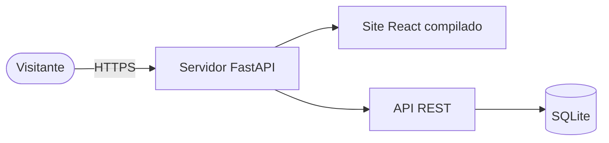

<p align="center">
  <picture>
    <source media="(prefers-color-scheme: dark)" srcset="public/brand/wolf-solutions-logo-dark.svg">
    
  </picture>
</p>

<p align="center">
  <strong>IA aplicada a processos de negócio.</strong><br>
  Site institucional com diagnóstico interativo para empresários, soluções por ramo e captação de contatos.
</p>

<p align="center">
  <a href="https://github.com/Flowzinnn/portfolio/actions/workflows/ci.yml"></a>
  
  
  
  
  
</p>

---

## Sobre o projeto

A **Wolf Solutions** desenvolve agentes de IA e automações sob medida para empresas. Este repositório contém o site da marca — pensado para transformar visitantes em conversas qualificadas:

1. O empresário encontra a solução para o **seu ramo** (clínicas, comércio, indústria, restaurantes, escritórios, imobiliárias).
2. Faz um **diagnóstico gratuito** de 10 perguntas e recebe, na hora, uma recomendação personalizada com relatório em PDF.
3. Se quiser, deixa o contato ali mesmo — e o lead chega organizado, já com o contexto do diagnóstico.

## Destaques

| | |
| --- | --- |
| **Interface** | Visual em vidro fosco (*glassmorphism*) com temas claro e escuro, animações suaves e rolagem fluida — respeitando quem pede menos movimento no sistema. |
| **Bilíngue** | Português e inglês em todo o site, com troca instantânea. |
| **Diagnóstico de IA** | 10 perguntas (incluindo múltipla escolha), pontuação de potencial, recomendação por ramo, relatório para salvar em PDF e captura de lead com consentimento. |
| **Soluções por ramo** | 6 páginas dedicadas com dores, casos de uso e ganhos de cada setor — boas para busca orgânica. |
| **Perguntas frequentes** | Acordeão acessível com dados estruturados (*schema.org*) para aparecer melhor no Google. |
| **Gestão de leads** | Painel administrativo com indicadores, funil por status e exportação para planilha. |
| **Conteúdo editável** | Textos, ramos, perguntas e ferramentas ficam em arquivos de dados — nada de mexer em componentes para atualizar o site. |
| **Qualidade** | TypeScript estrito, testes automatizados da API e verificação contínua do build e da imagem Docker a cada envio. |

## Arquitetura



Um único contêiner entrega o site estático e a API. O banco SQLite fica em um volume persistente — simples de manter, de fazer backup e mais do que suficiente para o volume de um site institucional.

## Tecnologias

| Camada | Ferramentas |
| --- | --- |
| Interface | React 19, TypeScript, Vite, Tailwind CSS 4, Motion, Lenis, Lucide |
| Conteúdo | Arquivos de dados em TypeScript, blog em Markdown |
| Servidor | Python 3.12, FastAPI, SQLAlchemy 2, Pydantic |
| Dados | SQLite |
| Entrega | Docker, Docker Compose, GitHub Actions |

## Estrutura

```
├── src/
│   ├── components/   # peças reutilizáveis: cartões de vidro, navegação, logotipo
│   ├── sections/     # seções da página inicial
│   ├── pages/        # páginas: início, ramos, blog
│   ├── data/         # conteúdo: serviços, ramos, diagnóstico, FAQ, ferramentas
│   ├── i18n/         # textos em português e inglês
│   └── content/blog/ # artigos em Markdown
├── backend/
│   ├── app/          # API, modelos do banco e validação
│   └── tests/        # testes automatizados
├── Dockerfile
└── docker-compose.yml
```

## Decisões de design

- **Conteúdo separado do código.** Todo texto vive em `src/data` e `src/i18n`: adicionar um ramo novo é copiar um bloco — ele ganha página própria e entra no diagnóstico automaticamente.
- **Vidro que não "pisca".** Os cartões animam a própria opacidade em vez de herdá-la de um elemento pai, para o desfoque de fundo não falhar durante a animação.
- **Leve por padrão.** Fontes servidas pelo próprio site, bibliotecas separadas em arquivos que o navegador guarda em cache, nada de 3D pesado.
- **Acessível.** Foco visível, navegação por teclado, rótulos para leitores de tela, contraste verificado nos dois temas e animações reduzidas quando o sistema pede.
- **Privacidade desde o início.** O diagnóstico é registrado de forma anônima; nome e contato só são guardados quando a pessoa preenche o formulário e autoriza.

## Rodar localmente

Requisitos: Node 24 e Python 3.12.

```bash
# site
npm install
npm run dev

# servidor (em outro terminal)
python -m venv .venv
.venv/Scripts/pip install -r backend/requirements-dev.txt     # Linux/Mac: .venv/bin/pip
.venv/Scripts/python -m uvicorn backend.app.main:create_app --factory --reload --port 8000
```

O site abre em http://localhost:5173. Testes da API: `.venv/Scripts/python -m pytest backend/tests`

## Autor

Desenvolvido por **Nicolas Wolf**, fundador da Wolf Solutions — [LinkedIn](https://www.linkedin.com/in/nicolas-wolf-3687961ba).

© 2026 Wolf Solutions. Código disponível para consulta; marca, logotipo e textos são de uso exclusivo da Wolf Solutions.
